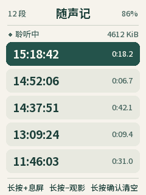

# Ai Passport Voice Recorder

[简体中文](README.md) · **English**

Wear your Ai Passport to capture conversations offline. The firmware listens for speech and saves it in clips. At the end of the day, export the clips as WAV files over USB to listen back or send them to a speech-to-text (STT) model.

## Quick start

1. Download this repository, turn on your Ai Passport, and connect it with a USB-C data cable.
2. Give the prompt below to an AI assistant that can access your computer’s serial ports. Flashing replaces the device’s current firmware and partition table.

   > Read [Agent.md](Agent.md), identify my Ai Passport, check the chip, flash capacity, and firmware images, then flash the recorder firmware to this device.

3. After the device restarts, say a sentence into the microphone. Wait about 10 seconds in a quiet room, then open the recording list to play it back.

## Everyday recording

The recorder uses speech patterns, volume, and background noise levels to decide when to start a clip. It keeps up to 0.48 seconds of audio before the trigger, preserves short pauses, and trims the middle of longer gaps without speech. After about 10 seconds without detected speech, it closes the clip. It can miss distant voices or words masked by noise.

| Recording specification | Current firmware |
| --- | --- |
| Codec | Wideband Speex, 16 kHz mono, fixed 16.8 kbps |
| Storage | 5 MiB dedicated to recordings on the 8 MB flash chip |
| Recording capacity | About 126 KB per minute, or **41.6 minutes** in theory. Usable capacity is slightly lower. |

If you speak only occasionally, those clips can span a whole day. Longer conversations fill the storage sooner. All-day battery life still needs to be measured.

## Controls

| Screen or mode | Action | Result |
| --- | --- | --- |
| Screen off | Press any function key (+, −, or OK) | Wake the screen and show the wallpaper |
| Wallpaper | Press any function key again | Open the recording list with the newest clip selected |
| Recording list | Press + / − | Select a newer / older clip |
| Recording list | Press OK | Play the selected clip. Press again to stop. The next playback starts from the beginning. |
| Recording list | Hold OK | Open the delete prompt. Press + to erase all recordings or − to keep them. The prompt cancels after 5 seconds. |
| During use | Hold + | Turn off the screen. Recording or playback continues. |
| Screen off, wallpaper, or list | Hold − | Toggle cinema mode (观影). Entering saves the current clip and stops recording. Hold again to resume listening. |

## Export and review

On Windows, double-click [desktop/start.cmd](desktop/start.cmd) and connect the powered-on device with a data cable. When the tool reports “USB 录音已就绪” (recordings ready), copy the WAV files from the new drive in File Explorer. The originals stay on the device. Once you have checked your local copies, run [desktop/reclaim.cmd](desktop/reclaim.cmd) to free up space.

Transcribe the WAV files with an STT model, then ask a language model to pick out topics, promises, and follow-up tasks from the day. Replay the corresponding clip when you need the exact wording.

## Hardware and porting

The images target the FoloToy Ai Passport with an **ESP32-C3 and 8 MB of flash**, an ES8311 audio codec, a 240 × 320 display, and three function keys. To port the source to another board, adapt its drivers, pin assignments, and storage layout before flashing. The [agent guide](Agent.md) and [project notes](Doc.md) cover flashing, configuration, and recovery in Chinese.

## Roadmap

The next step is to have the device connect to a NAS when you plug it in to charge at home. A Docker service would receive the recordings, transcribe them, analyze the conversations, and send a summary. The NAS/Docker prototype still needs validation and will be published in this repository when ready. Other follow-on projects are planned for separate repositories.
