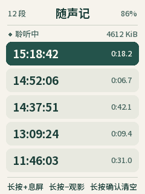

# 随声记 · Ai Passport 长时间录音固件

**简体中文** · [English](README.en.md)

把 Ai Passport 戴在身边，它会离线监听，在检测到人声时保存片段。晚上用 USB 导出 WAV，就可以回听当天的对话，或交给语音转文字（STT）模型整理。

## 快速开始

1. 下载本仓库，用支持数据传输的 USB-C 线连接已开机的 Ai Passport。
2. 把下面这句话交给能够访问本机串口的 AI 助手。刷写会替换设备现有固件和分区表。

   > 请阅读本仓库的 [Agent.md](Agent.md)，识别我的 Ai Passport，核对芯片、Flash 容量和镜像，然后为这台设备刷入录音固件。

3. 设备重启后，对着麦克风说一句话，安静等待约 10 秒，再进入录音列表回听。

## 随身录音

固件结合语音特征、音量和环境底噪判断何时开录。它会保留句首最多 0.48 秒的声音，保留对话中自然的短停顿，并剪掉较长无人声间隔的中间部分。连续约 10 秒没有检出人声，就保存为一段。远处的轻声或被噪声盖住的话可能漏录。

| 录音规格 | 当前固件 |
| --- | --- |
| 编码 | Speex 宽带，16 kHz 单声道，固定 16.8 kbps |
| 容量 | 8 MB Flash 中有 5 MiB 专门用于录音 |
| 可存时长 | 每分钟约 126 KB，理论上限约 **41.6 分钟**，实际略少 |

一天里偶尔说几句话，这些片段可以分布在从早到晚的不同时间。累计谈话越多，空间用得越快。全天佩戴的电池续航仍待实测。

## 按键操作

| 场景 | 操作 | 结果 |
| --- | --- | --- |
| 息屏时 | 短按任一功能键（＋、－、OK） | 亮屏，显示壁纸 |
| 壁纸页 | 再短按任一功能键 | 打开录音列表，选中最新一段 |
| 录音列表 | 短按 ＋ / － | 向上选较新的录音 / 向下选较早的录音 |
| 录音列表 | 短按 OK | 播放选中片段，再按停止。下次从头播放 |
| 录音列表 | 长按 OK | 打开清空确认页。短按 ＋ 清空全部录音，短按 － 保留，5 秒超时自动取消 |
| 使用中 | 长按 ＋ | 立即息屏，当前录音或播放继续 |
| 息屏、壁纸或列表 | 长按 － | 切换影院模式（屏幕显示「观影」）。进入时保存当前片段并停录，再长按恢复监听 |

## 导出与回顾

在 Windows 双击 [desktop/start.cmd](desktop/start.cmd)，保持工牌开机并接上数据线。看到「USB 录音已就绪」后，从资源管理器中新出现的盘符复制 WAV。工牌会保留原件，核对本机副本后可用 [desktop/reclaim.cmd](desktop/reclaim.cmd) 释放设备空间。

将 WAV 交给 STT 模型，再让大模型根据转写提取当天谈到的事、答应过的事和待办。需要确认原话时，可以回听对应片段。

## 硬件与移植

发布镜像面向 FoloToy Ai Passport 的 **ESP32-C3 / 8 MB Flash** 型号，使用 ES8311 音频编解码器、240 × 320 屏幕和三个功能键。其他开发板可以参考源码移植。刷入前需适配板级驱动、引脚和存储布局。刷写、配置和恢复步骤见 [Agent.md](Agent.md) 和 [项目说明](Doc.md)。

## 路线图

下一步是让工牌在回家插上充电线后自动连接 NAS，将录音上传给 Docker 服务，由服务完成转写、整理对话和推送摘要。NAS/Docker 原型仍待验证，完成后会在本仓库发布。其他后续项目计划在独立仓库开放。
